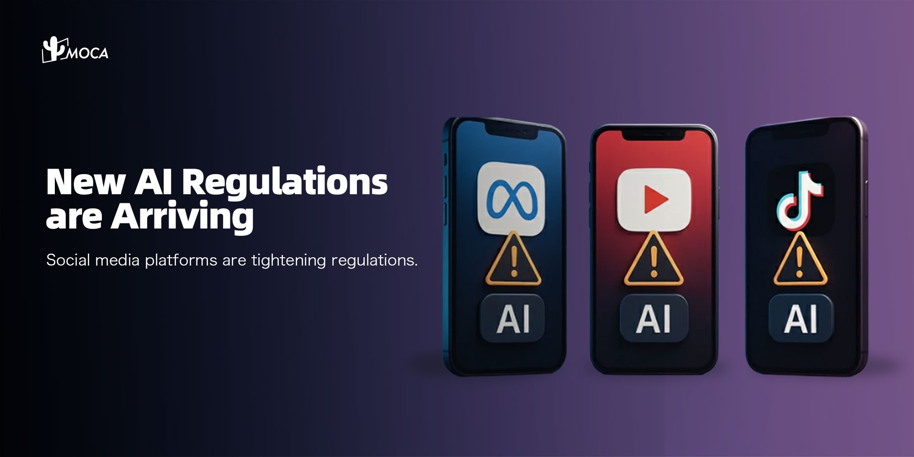

Meta, YouTube and TikTok all ask creators to label realistic AI-generated content, and October 2025 added three more pieces: WhatsApp's AI Providers terms, YouTube's likeness detection rollout and a draft AI-label rule in India. For brands and influencers the common thread is clear labeling, so viewers can tell at a glance whether content is synthetic. This guide sets out what each platform requires, with links to the official pages.

> **Freshness note:** This article was first published on October 24, 2025. Platform and government rules on AI content change often, and some have changed since then. Each section below says which date its source describes. Check the linked policy pages for the current text before you plan a campaign.

## What changed for AI content in October 2025?

October 2025 added three moves: WhatsApp's AI Providers terms, YouTube's likeness detection rollout and India's draft AI-label rule. The labeling duties at Meta, YouTube and TikTok were already in place by 2024, as the sources below show.

| Platform or regulator | Rule | Date |
|---|---|---|
| Meta (Facebook, Instagram) | Creators must use the disclosure tool for photorealistic video or realistic-sounding audio. Ads made with Meta's generative AI tools carry an "AI info" label. | Disclosure tool announced February 2024; ad labels described February 2025 |
| WhatsApp (Meta) | "AI Providers" clause bars AI providers whose AI assistant is the primary service from the WhatsApp Business Platform | Terms reported October 18, 2025; effective January 15, 2026 |
| YouTube | Creators must disclose realistic AI-generated or altered content | Announced March 18, 2024 |
| YouTube | Likeness detection starts rolling out to Partner Program creators | October 2025 |
| TikTok | Creators must label realistic AI-generated content | In place by May 2024 |
| India (MeitY) | Draft rules on labeling synthetically generated information | Published October 22, 2025 |

## What does Meta require for AI-generated content?

In its [February 2024 announcement](https://about.fb.com/news/2024/02/labeling-ai-generated-images-on-facebook-instagram-and-threads/), Meta said it would require people to use its disclosure and label tool when they post organic content with a photorealistic video or realistic-sounding audio that was digitally created or altered, and that it may apply penalties if they fail to do so. In [April 2024](https://about.fb.com/news/2024/04/metas-approach-to-labeling-ai-generated-content-and-manipulated-media/), Meta said providing transparency and context through labels is now the better way to handle manipulated media than removing it. Labels now read "AI info" and appear when Meta detects industry-standard AI signals or when people disclose that content is AI-generated.

For advertisers, [Meta's February 2025 ads post](https://about.fb.com/news/2025/02/gen-ai-transparency-metas-ads-products/) explains that ads created or significantly edited with Meta's generative AI creative features receive an AI label. Meta updated that post on June 1, 2026. It says "AI info" labels will sit inside a new "About this ad" menu, and that it will also detect ads edited with third-party AI tools through industry-standard signals.

WhatsApp is a separate case. [WhatsApp's Business Solution Terms](https://www.whatsapp.com/legal/business-solution-terms) (section 4.7) prohibit providers of large language models and general-purpose AI assistants from using the WhatsApp Business Platform when that AI is the primary functionality they make available, as Meta determines. [TechCrunch reported on October 18, 2025](https://techcrunch.com/2025/10/18/whatssapp-changes-its-terms-to-bar-general-purpose-chatbots-from-its-platform/) that the terms take effect on January 15, 2026. The wording applies where AI is the main product on offer. It does not reach a business that uses AI only around its own customer service.

## What does YouTube require, and what is likeness detection?

YouTube requires creators to disclose realistic AI-generated or altered content, a rule it [announced on March 18, 2024](https://blog.youtube/news-and-events/disclosing-ai-generated-content/). Its [Help Center page](https://support.google.com/youtube/answer/14328491) lists the content that needs disclosure:

1. Makes a real person appear to say or do something they didn't do.
2. Alters footage of a real event or place.
3. Generates a realistic scene that didn't actually occur.
4. Creates music that is the main focus of the video.

Creators disclose during upload through the "AI use" setting in YouTube Studio. YouTube may also label content automatically when it was made with YouTube's own generative AI tools, contains C2PA metadata, or is detected by its systems as AI-generated or altered. The same page says disclosing alone won't limit a video's audience or affect monetization eligibility, while creators who consistently choose not to disclose may face a manual label or penalties, including content removal or suspension from the YouTube Partner Program.

Likeness detection is the October 2025 addition. YouTube's [October 2025 creator news](https://blog.youtube/news-and-events/youtube-updates-october-2025/) says it began rolling out the technology to creators in the YouTube Partner Program. Per [YouTube's likeness detection page](https://support.google.com/youtube/answer/16440338), the tool helps creators find videos where their face appears to be altered or generated by AI, lets them review matches and request removal through the privacy complaint process, and is currently an experimental feature. Creators must be over 18 and complete identity verification with a government ID and a selfie video.

## How does TikTok label AI-generated content?

TikTok said in [May 2024](https://newsroom.tiktok.com/en-us/partnering-with-our-industry-to-advance-ai-transparency-and-literacy) that it had required creators to label realistic AI-generated content for over a year, and that it had begun automatically labeling content uploaded from other platforms by reading C2PA Content Credentials.

TikTok has since re-released its Community Guidelines. The [version released August 25, 2026 and effective September 24, 2026](https://www.tiktok.com/community-guidelines/en/integrity-authenticity) says creators must label AI-generated or significantly edited content that shows realistic-looking scenes or people, and that unlabeled content may be removed, restricted or labeled by TikTok, depending on the harm it could cause. The guidelines also do not allow AI-generated content that misleads about matters of public importance or harms individuals.

TikTok's [AI-generated content page](https://www.tiktok.com/safety/en/policies-and-engagement/supporting-responsible-transparent-ai-generated-content) adds that it prohibits AI content that falsely shows public figures endorsing something, and does not allow the likeness of people under 18 or of private adults used without permission. In a [19 November 2025 update](https://newsroom.tiktok.com/more-ways-to-spot-shape-and-understand-ai-content?lang=en), TikTok said its labelling, which combines creator tools, detection models and C2PA Content Credentials, had labeled over 1.3 billion videos. It also said it was testing invisible watermarking.

For TikTok's other rules for brands in Southeast Asia, such as sponsored-post disclosure, commercial music and gambling limits, see [TikTok compliance rules for Southeast Asia brands](/news/tiktoks-new-compliance-wave-how-southeast-asian-brands-must-adapt-in-2025).

## What is India's rule on AI labels?

India proposed visible AI labels and permanent metadata in October 2025, then amended its IT Rules in February 2026. On October 22, 2025, the Ministry of Electronics and Information Technology (MeitY) published an [explanatory note](https://www.meity.gov.in/static/uploads/2025/10/8e40cdd134cd92dd783a37556428c370.pdf) on proposed changes to the IT Rules, 2021. In that draft:

- Intermediaries that offer tools for creating synthetic content would have to label it or embed a permanent unique identifier.
- The label would have to cover at least 10% of the surface area of a visual display, or the initial 10% of an audio clip's duration, per the [MeitY note](https://www.meity.gov.in/static/uploads/2025/10/8e40cdd134cd92dd783a37556428c370.pdf).
- Significant social media intermediaries would have to obtain a user declaration on whether uploaded content is synthetic and use reasonable technical measures to verify it.

The government later acted on the proposal. According to a [Press Information Bureau release dated August 6, 2026](https://www.pib.gov.in/PressReleasePage.aspx?PRID=2295500), the IT Rules were amended on February 10, 2026 to address synthetically generated information, including clear labeling and traceable metadata for permissible AI-generated content. The release does not repeat the draft's 10% figure, so read the notified rules themselves for the final label requirements before running campaigns in India. For a wider view of the market, see [how influencer marketing is expected to expand in India](/news/influencer-marketing-expected-to-expand-at-a-rapid-clip-in-india).

## How do these rules affect brands and influencers?

For brands, AI content labels become part of reputation management. A label on an ad or a creator post tells viewers that the content was machine-made or machine-altered, and that can change how they judge a brand's claims. Meta and YouTube also label content automatically when AI signals are detected, so a brand cannot rely on staying quiet about AI use.

For creators, the rules cut both ways. Likeness detection gives Partner Program creators a way to find and report AI-altered videos of their own face. At the same time, creators who publish realistic AI content without disclosure risk labels or penalties on YouTube, Meta and TikTok.

## What should brands do now?

MOCA's view, based on running influencer campaigns in Southeast Asia and South Asia: in markets where social commerce runs on trust, viewers tend to respond to recommendations from real people, so AI disclosure should be handled openly rather than hidden. A practical checklist:

1. Put AI disclosure in the creator brief: State which AI uses must be disclosed (realistic people, altered footage, synthetic voice) and which platform setting to use.
2. Review content before it goes live: Check each post for realistic AI elements and for metadata that platforms may read, such as C2PA.
3. Keep AI in a support role: Use AI for data analysis, editing and production help, and let local creators carry the personality and storytelling.
4. Check market-specific rules: India amended its rules on February 10, 2026. WhatsApp's AI Providers clause has its own effective date.
5. Log your decisions: Keep a record of what was disclosed and when, so you can answer a platform query or a client question.

Related reading: [how TikTok, YouTube and Instagram reshaped creator policies in 2025](/news/platform-policy-tightening-2025-how-tiktok-youtube-instagram-are-reshaping-the-creator-economy), [how to avoid common pitfalls when running influencer marketing in Indonesia](/news/how-to-drive-real-growth-in-indonesia-with-influencer-marketing-avoid-pitfalls-unlock-lasting-value) and [how micro and nano influencers are changing marketing in Southeast Asia](/news/micro-and-nano-influencers-redefining-marketing-in-southeast-asia).

## Frequently Asked Questions

### Do creators have to label AI-generated content on YouTube, Meta and TikTok?

Yes, when the content looks realistic. YouTube requires creators to disclose realistic AI-generated or altered content, Meta requires its disclosure and label tool for photorealistic video or realistic-sounding audio, and TikTok requires labels on realistic AI-generated or significantly edited content.

### What is YouTube's likeness detection?

It is a tool that helps creators find videos where their face appears to be altered or generated by AI. Creators review any matches and can request removal through the privacy complaint process. YouTube began rolling it out to Partner Program creators in October 2025 and describes it as experimental.

### Did WhatsApp ban all AI chatbots?

No. The AI Providers clause in the WhatsApp Business Solution Terms bars AI providers from using the WhatsApp Business Platform when their AI technology is the primary functionality they offer, rather than an incidental or ancillary one. It took effect on January 15, 2026.

### What did India propose for AI-generated content labels in October 2025?

The October 22, 2025 draft would have required tools that create synthetic content to add a permanent identifier and a visible label covering at least 10% of the visual area, or the first 10% of an audio clip. India later amended its IT Rules on February 10, 2026, so check the current text.

### Does disclosing AI content reduce reach or earnings on YouTube?

YouTube says that disclosing AI content alone will not limit a video's audience or affect its eligibility to earn money. Creators who consistently choose not to disclose may get a label applied by YouTube or face penalties.

## About MOCA Technology

Founded in 2012, MOCA Technology is an influencer marketing and programmatic advertising platform serving brands across Asia-Pacific. MOCA operates [KOLPlanet](https://www.kolplanet.com), a creator marketplace connecting brands with influencers across Indonesia, Thailand, Vietnam, the Philippines, Malaysia, Japan, South Korea, Taiwan, and India.

MOCA's core services include influencer marketing strategy and execution, creator-brand matchmaking through KOLPlanet, innovative branding solutions, and cross-platform programmatic advertising. The company is headquartered in Shanghai with a local team in Jakarta and regional operations across Southeast Asia.

**Planning influencer or creator campaigns in Southeast Asia or India?** Talk to MOCA Technology about strategy and creator matchmaking through KOLPlanet.

Contact: [business@moca-tech.net](mailto:business@moca-tech.net) | [www.moca-tech.net](https://www.moca-tech.net)

*First published October 24, 2025. Updated October 25, 2026 with a freshness note, a clearer structure, an FAQ and source links to Meta, WhatsApp, YouTube, TikTok and Indian government pages. The original "Effective Date: October 2025" lines for Meta, YouTube and TikTok are corrected to the dates in those sources. Figures and rules are as described on the dates stated in each section; the 2026 items are marked with their own dates.*
