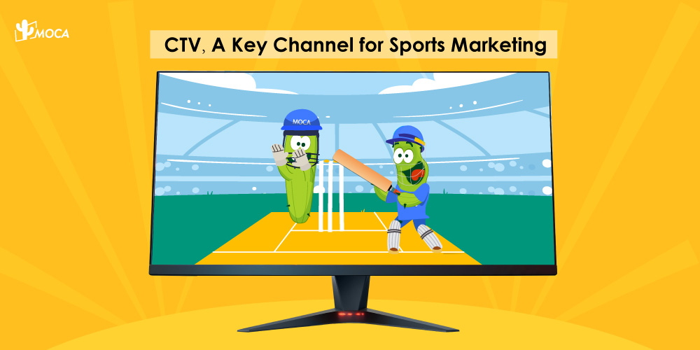

India's smart TV boom is transforming CTV ads by turning connected TV (CTV) into a channel that reaches people at scale. In a November 2023 online survey of 4,044 respondents in India, run by GroupM (now WPP Media) with Ampere Analysis, [47% said they own a smart TV](https://www.datocms-assets.com/153350/1748296377-the_changing_landscape_of_indian_television-2nd-edition_2024-2.pdf). GroupM also expected CTV to [pass 45 million households by the end of 2024](https://www.wppmedia.com/news/changing-indian-television). This article, first published in December 2024, walks through those figures, the sports audience they open up, and what a US shopper survey suggests about how viewers react to ads on the big screen. For the basics of CTV and how it differs from OTT, see our [explainer on CTV advertising in India](/news/the-rise-of-ctv-advertising-in-india).

## How many people in India own a smart TV?

Nearly half of respondents, 47%, own a smart TV. Among owners, 65% use it as their main device for watching TV content. Of the 53% who did not own one, 23% said they would buy a smart TV within the next year. Because the respondents were online, the numbers describe connected audiences and do not cover every household in India.

| Metric | Figure | Source |
| --- | --- | --- |
| Respondents who own a smart TV | 47% | Survey of 4,044 online respondents, November 2023 |
| Smart TV owners who use it as their main TV device | 65% | Same survey |
| Non-owners planning to buy a smart TV within a year | 23% | Same survey |
| Smart TVs as a share of India's TV shipments, first half of 2023 | 91% | Counterpoint Research, cited in the [GroupM report](https://www.datocms-assets.com/153350/1748296377-the_changing_landscape_of_indian_television-2nd-edition_2024-2.pdf) |

## How big will CTV get in India?

GroupM expected connected TV to [reach more than 45 million households by the end of 2024](https://www.wppmedia.com/news/changing-indian-television). The same report put India's TV households at 217 million in 2023. [BestMediaInfo's coverage of GroupM's This Year Next Year report](https://bestmediainfo.com/2024/02/ctv-homes-to-reach-45-million-in-2024-groupm-tyny) described the 2024 figure as 21% of India's TV homes.

## Why is CTV a strong fit for sports marketing?

CTV fits sports marketing because sports fans are a large, higher-income group on connected screens: 44% of respondents (1,781 of 4,044) said they enjoy watching sports. Sports fans reported 13% higher household income than other respondents, and they were more likely than average to have watched online video services that hold sports rights, according to the [GroupM report](https://www.datocms-assets.com/153350/1748296377-the_changing_landscape_of_indian_television-2nd-edition_2024-2.pdf). The report calls sports fans a valuable audience for advertisers because they actively engage with the events they watch. For a cricket example, read our piece on [CTV and influencer strategies for IPL 2025](/news/ipl-2025-ctv-influencer-strategies-to-dominate-indias-150m-digital-audience).

## How do viewers respond to ads on CTV?

The same report found that [65% of Indian internet users watch ad-supported video content](https://www.wppmedia.com/news/changing-indian-television), and 64% had watched a service with addressable TV capabilities within the last month.

For behavior on the TV screen itself, this article draws on a survey from outside India. In February 2024, Roundel, a US retail media network, surveyed 2,876 shoppers of its parent retailer for its [CTV x Commerce report](https://roundel.com/wp-content/uploads/2024/06/Innovid_Roundel_CTV_Commerce_Report.pdf). Read them as a signal from a single market that says little about Indian viewers directly.

On time spent, [Roundel found](https://roundel.com/wp-content/uploads/2024/06/Innovid_Roundel_CTV_Commerce_Report.pdf) that 57% of the guests surveyed use a streaming service supported by ads. Their weekly streaming time rose from 15.6 hours to 22 hours, an increase of 40%, and 26% said their time spent streaming had increased over the past 12 months.

On behavior, the [same report](https://roundel.com/wp-content/uploads/2024/06/Innovid_Roundel_CTV_Commerce_Report.pdf) found that 59% often or always have a second device in hand while streaming. 49% are likely to search for an item after seeing it on TV, and 62% are more likely to scan an on-screen QR code than to use a remote to click through and learn or buy.

## What should advertisers in India take from this?

Four points follow from the figures above.

1. Size the audience from smart TV ownership and CTV household counts.
2. Put sports in the plan early, since sports fans are a large and higher-income group in the survey.
3. Test QR codes and search-driven creative on CTV, and measure them against your own results instead of the US figures above.
4. Record the year and survey base next to every forecast. The 45 million household figure was a 2024 projection.

For more on how CTV fits into a wider plan, see [CTV, the dominant force in advertising](/news/ctv-the-dominant-force-in-advertising-ef-bf-bc) and [How CTV is revolutionizing advertising](/news/how-ctv-is-revolutionizing-advertising). To discuss CTV advertising for your brand, contact MOCA at [business@moca-tech.net](mailto:business@moca-tech.net).

## Frequently Asked Questions

### How many households in India have connected TV?

GroupM expected connected TV to reach more than 45 million Indian households by the end of 2024. India had 217 million TV households in 2023, and BestMediaInfo reported that GroupM put CTV homes at 21% of TV homes in 2024. In the GroupM and Ampere Analysis survey, 47% of respondents said they own a smart TV.

### Is smart TV ownership still growing in India?

Yes, according to the 2023 GroupM and Ampere Analysis survey. Of the respondents who did not own a smart TV, 23% said they would buy one within the next year. Counterpoint Research data cited in the same report showed smart TVs were 91% of all TV shipments in India in the first half of 2023.

### Why is CTV a good fit for sports advertising in India?

In the survey, 44% of respondents enjoyed watching sports, and sports fans reported 13% higher household income than other respondents. The report also found sports fans were more likely than average to have watched online video services that hold sports rights.

### What share of Indian internet users watch ad-supported video?

The GroupM and Ampere Analysis report found that 65% of Indian internet users watch ad-supported video content, and 64% had watched a service with addressable TV capabilities within the last month.

### Does the Roundel survey describe Indian viewers?

No. Roundel, a US retail media network, surveyed 2,876 shoppers of its parent retailer in February 2024. Its findings, such as 57% using an ad-supported streaming service and 62% being more likely to scan an on-screen QR code than click with a remote, show how shoppers respond to CTV ads in one market and should not be read as Indian benchmarks.

*First published December 11, 2024. Updated October 25, 2026 with a summary, an FAQ and source links. Figures are as reported in 2023 and 2024. Survey figures were corrected to match the original reports, and a market-size forecast without a traceable source was removed.*
