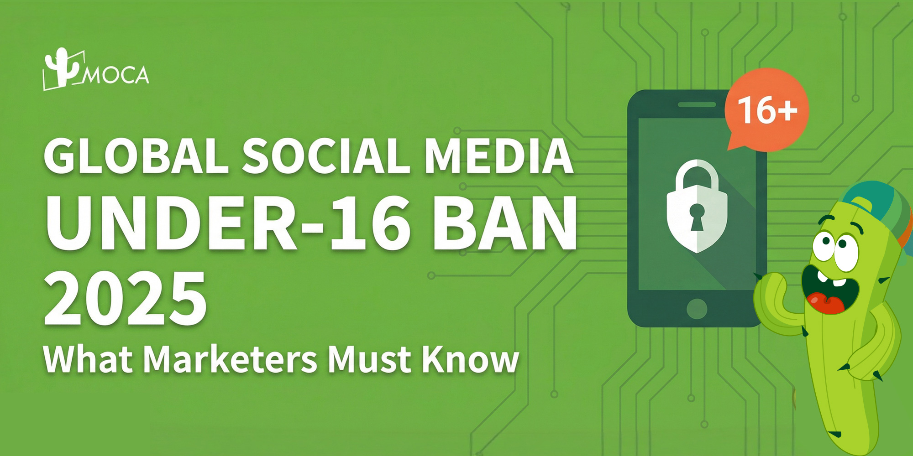

As of October 25, 2026, three markets are enforcing minimum-age rules for social media accounts: Australia since December 2025, Indonesia since March 2026 and Malaysia since June 2026. Brazil requires accounts for users under 16 to be [linked to a guardian](https://agenciabrasil.ebc.com.br/en/politica/noticia/2026-03/brazil-digital-statute-protect-minors-online-comes-force). Denmark and Norway are still drafting laws, and France's under-15 ban passed parliament in July 2026 but was struck down by the Constitutional Council in August. This guide lists each country's status with a dated official source and what it means for brands advertising to young audiences in Asia-Pacific.

## What Is the Under-16 Social Media Ban?

The under-16 ban is a legal duty on platforms to stop children below a set age from holding social media accounts. Australia went first, and eSafety calls the law world-first. [According to the eSafety Commissioner](https://www.esafety.gov.au/about-us/industry-regulation/social-media-age-restrictions), since December 10, 2025, age-restricted platforms must take reasonable steps to prevent Australians under 16 from creating or keeping an account.

eSafety describes the rule as a delay to having accounts, not a ban on the internet, and [confirms it carries no penalties](https://www.esafety.gov.au/about-us/industry-regulation/social-media-age-restrictions) for under-16s or their parents. [Platforms face court-imposed fines](https://www.esafety.gov.au/about-us/industry-regulation/social-media-age-restrictions) of up to 300,000 penalty units, which eSafety currently converts to AUD 109.2 million. The earlier cap was AUD 49.5 million, and [the Prime Minister announced in June 2026](https://www.pm.gov.au/media/stronger-powers-and-double-penalties-world-leading-social-media-law) that it would be doubled. Parliament passed the [strengthening Act](https://www.legislation.gov.au/C2026A00083/asmade) on September 10, 2026.

[eSafety lists](https://www.esafety.gov.au/about-us/industry-regulation/social-media-age-restrictions) Facebook, Instagram, Snapchat, Threads, TikTok, Twitch, X, YouTube, Kick and Reddit as age-restricted platforms. Online gaming and standalone messaging apps are among the services excluded under the rules.

> **Key finding:** Australia's under-16 rule has applied since December 10, 2025. [eSafety's list](https://www.esafety.gov.au/about-us/industry-regulation/social-media-age-restrictions) covers ten named platforms, including YouTube and Reddit, and the maximum penalty for platforms was doubled to 300,000 penalty units (about AUD 109.2 million) by an Act passed on September 10, 2026.

## Which Countries Are Implementing Age Restrictions?

Three countries enforce minimum-age rules for social media accounts as of October 25, 2026, and five more have laws, bills or court rulings in progress. Rules change quickly, so check the linked source before you plan a campaign.

| Country | Rule | Status | Source |
|---|---|---|---|
| Australia | Platforms must prevent under-16s from holding accounts | In force since Dec 10, 2025; penalties doubled by Act passed Sept 10, 2026 | [eSafety](https://www.esafety.gov.au/about-us/industry-regulation/social-media-age-restrictions) |
| Indonesia | Under-16 accounts disabled on high-risk platforms | Started Mar 28, 2026 for eight platforms | [Komdigi](https://portal.komdigi.go.id/kanal-publik/berita-kini/10066) |
| Malaysia | No own social media account under 16; age verification by platforms | In effect since Jun 1, 2026 | [MCMC](https://www.mcmc.gov.my/en/onsa/under-16) |
| Brazil | Under-16 accounts must be linked to a legal guardian; self-declared age banned | Digital ECA in force since Mar 17, 2026 | [Agência Brasil](https://agenciabrasil.ebc.com.br/en/politica/noticia/2026-03/brazil-digital-statute-protect-minors-online-comes-force) |
| India | Verifiable parental consent for processing a child's (under 18) data; no targeted ads to children | DPDP Rules notified Nov 14, 2025, 18-month phased compliance | [PIB](https://static.pib.gov.in/WriteReadData/specificdocs/documents/2025/nov/doc20251117695301.pdf) |
| Denmark | Age limit of 15 for the largest platforms | Draft bill in consultation until Oct 5, 2026; proposed start Jul 1, 2027 | [Plesner](https://plesner.com/en/news/new-draft-bill-social-media-age-limits-denmark) |
| Norway | Age limit applies from January 1 of the year a child turns 16 | Bill due in parliament before end of 2026; not yet law | [Norwegian Government](https://www.regjeringen.no/en/whats-new/norwegian-social-media-age-restrictions-law-on-track-to-be-introduced-this-year-this-is-how-the-age-limit-for-social-media-will-work/id3157276/) |
| France | Ban for under-15s | Passed Jul 21, 2026; Article 1 struck down by the Constitutional Council on Aug 14, 2026 | [Conseil constitutionnel](https://www.conseil-constitutionnel.fr/actualites/communique/decision-n-2026-911-dc-du-14-aout-2026-communique-de-presse) |

Source: official government, regulator and court pages linked in the table; Denmark per law firm Plesner's summary of the draft bill.

Two details differ from what many 2025 summaries said. [Denmark's draft bill](https://plesner.com/en/news/new-draft-bill-social-media-age-limits-denmark) drops the earlier idea of parental consent for 13 and 14-year-olds, so the limit of 15 is absolute. [France's ban](https://www.theguardian.com/world/2026/jul/21/france-ban-social-media-access-under-15s) was approved 279 to 81 in the National Assembly, but the Constitutional Council ruled that a blanket ban was a disproportionate limit on freedom of expression and lacked privacy safeguards.

> **Key finding:** As of October 25, 2026, Australia, Indonesia and Malaysia enforce minimum-age rules for social media accounts, Brazil requires guardian-linked accounts for under-16s, and Denmark and Norway have bills pending. France's under-15 ban was struck down on August 14, 2026, so it is not in force.

## Why Are Governments Acting Now?

Public concern is high and measurable. A June 2025 Special Eurobarometer on the Digital Decade, [summarized by the European Parliament](https://www.europarl.europa.eu/at-your-service/files/be-heard/eurobarometer/2026/en-public-opinion-cult-spring-2026.pdf), found that 93% of EU respondents want urgent public action on social media's negative impact on children's mental health, and 92% want urgent action on cyberbullying and online harassment.

In Indonesia, [a YouGov survey](https://yougov.com/articles/51591-indonesians-support-governments-proposal-to-regulate-social-media-usage-for-children-but-are-divided-on-its-effectiveness) of 892 adults in January 2025 found that 84% of parents with at least one child under 18 backed a minimum age for social media. Only 50% of parents believed the rule would work, 17% doubted it and 33% were neutral.

Governments are also pressing platforms on delivery. [Australia's communications minister said in June 2026](https://www.pm.gov.au/media/stronger-powers-and-double-penalties-world-leading-social-media-law) that she was not satisfied companies were doing everything they could, and eSafety is investigating five platforms: Facebook, Instagram, Snapchat, TikTok and YouTube.

> **Key finding:** In Indonesia, 84% of parents with a child under 18 support a minimum age for social media but only 50% believe it will be effective, according to a [January 2025 YouGov survey](https://yougov.com/articles/51591-indonesians-support-governments-proposal-to-regulate-social-media-usage-for-children-but-are-divided-on-its-effectiveness) of 892 adults. In the EU, [93% want urgent action](https://www.europarl.europa.eu/at-your-service/files/be-heard/eurobarometer/2026/en-public-opinion-cult-spring-2026.pdf) on children's mental health online.

## How Do Platforms Check Age?

Platforms use different age-check methods in each country, because each regulator sets a different standard.

1. **Australia:** platforms must take "reasonable steps". eSafety's guidance draws on the government's Age Assurance Technology Trial, whose preliminary findings said age checks can be private, robust and effective when deployed the right way and combined with other techniques.
2. **Malaysia:** MCMC says it takes a technology-neutral approach, but expects verification methods based on government-issued records or documents where required.
3. **Brazil:** [simple self-declaration of age is prohibited](https://agenciabrasil.ebc.com.br/en/politica/noticia/2026-03/brazil-digital-statute-protect-minors-online-comes-force), and in March 2026 the government was due to publish a decree on which verification mechanisms are accepted.
4. **Denmark:** the bill does not fine platforms directly. It relies on age verification duties that already come from Article 28 of the EU Digital Services Act.

Circumvention is still an open question. [Australia's government said in June 2026](https://www.pm.gov.au/media/stronger-powers-and-double-penalties-world-leading-social-media-law) that more than 5 million under-16 accounts had been removed, deactivated or restricted since December, yet it also said there are still too many children on social media and that it was strengthening enforcement.

> **Key finding:** Age-check rules differ by market: Australia sets a "reasonable steps" standard, Malaysia points to government-issued records, Brazil bans self-declared age, and Denmark would rely on the EU Digital Services Act. Brands should expect no single verification standard across Asia-Pacific.

## How Does This Affect Marketing Strategies?

**Reachable audiences shrink.** [eSafety reported](https://www.esafety.gov.au/about-us/industry-regulation/social-media-age-restrictions) that age-restricted platforms removed access to 4.7 million under-16 accounts across Australia by mid-December 2025. In Indonesia, [Komdigi says](https://portal.komdigi.go.id/kanal-publik/berita-kini/10541) about 28 million children are now covered by protections, and Roblox moved about 23 million under-16 accounts to stricter settings. Brands that rely on teen reach, such as gaming, snacks and entertainment, should re-check their targeting and audience estimates in these markets. For gaming context, see our [overview of India's gaming industry](/news/navigating-opportunities-and-challenges-in-india-gaming-industry).

**Ad targeting rules matter as much as account rules.** [India's DPDP Act](https://www.meity.gov.in/static/uploads/2024/06/2bf1f0e9f04e6fb4f8fef35e82c42aa5.pdf) bars tracking or behavioural monitoring of children and targeted advertising directed at them (section 9(3)); a child is anyone under 18. [Brazil's Digital ECA](https://agenciabrasil.ebc.com.br/en/politica/noticia/2026-03/brazil-digital-statute-protect-minors-online-comes-force) prohibits advertising it considers predatory, unfair or misleading toward children and adolescents.

**Compliance has to be market-specific.** Age thresholds run from 15 (Denmark, and France's struck-down law) to 16 (Australia, Indonesia, Malaysia), with Norway at 15 to 16 depending on birth year, and the methods and dates differ. Our [analysis of platform policy changes](/news/platform-policy-tightening-2025-how-tiktok-youtube-instagram-are-reshaping-the-creator-economy) and of [AI content rules](/news/ai-content-regulations-tighten-how-global-social-media-platforms-are-cracking-down-on-ai-generated-content) shows the same pattern: rules arrive market by market.

> **Key finding:** In Australia, [4.7 million under-16 accounts](https://www.esafety.gov.au/about-us/industry-regulation/social-media-age-restrictions) lost access by mid-December 2025, and in Indonesia [about 28 million children](https://portal.komdigi.go.id/kanal-publik/berita-kini/10541) now fall under PP TUNAS protections. Brands should audit teen-facing targeting, and in India and Brazil, targeted advertising to children is also restricted by law.

## What Is Happening in Southeast Asia and India?

Indonesia and Malaysia enforce account limits, while India regulates through data protection law.

### Indonesia

Indonesia's PP TUNAS (Government Regulation 17 of 2025) became enforceable in March 2026. [Komdigi's Ministerial Regulation 9 of 2026](https://portal.komdigi.go.id/kanal-publik/berita-kini/10066) set March 28, 2026 as the date for disabling accounts of under-16s on high-risk platforms, starting with YouTube, TikTok, Facebook, Threads, Instagram, X, Bigo Live and Roblox. In a [six-month review on September 14, 2026](https://portal.komdigi.go.id/kanal-publik/berita-kini/10541), Komdigi said 252 products, services and features from 94 operators had completed self-assessment, and 60 had been verified, 22 of them as high-risk. The high-risk services formally designated so far include Lazada, Blibli, Vidio, Pinterest and X. Operators have until December 31, 2026 to finish self-assessment, after which Komdigi can classify a service as high-risk directly. For the audience behind these rules, see [how to win over Indonesia's next-gen shoppers](/news/cracking-the-code-how-to-win-over-indonesias-next-gen-shoppers).

### India

India chose a data-protection route. The [DPDP Rules were notified on November 14, 2025](https://static.pib.gov.in/WriteReadData/specificdocs/documents/2025/nov/doc20251117695301.pdf) with an 18-month phase-in, and require verifiable consent from a parent or guardian before processing a child's data, with exceptions for services such as healthcare and education. The [DPDP Act](https://www.meity.gov.in/static/uploads/2024/06/2bf1f0e9f04e6fb4f8fef35e82c42aa5.pdf) defines a child as anyone under 18. There is no platform ban, but the consent and ad-targeting limits apply to marketers directly.

### Malaysia

[MCMC states](https://www.mcmc.gov.my/en/onsa/under-16) that from June 1, 2026 platforms must verify user age. Children aged 15 and below should have no social media account of their own, though a child under 16 may use social media through a parent's account with supervision. Users aged 16 and 17 may use social media with parental controls and default privacy settings at the highest protection level.

> **Key finding:** Indonesia's PP TUNAS [began disabling under-16 accounts](https://portal.komdigi.go.id/kanal-publik/berita-kini/10066) on eight high-risk platforms on March 28, 2026, [Malaysia's age-verification duty](https://www.mcmc.gov.my/en/onsa/under-16) started June 1, 2026, and India's [DPDP Rules](https://static.pib.gov.in/WriteReadData/specificdocs/documents/2025/nov/doc20251117695301.pdf) phase in over 18 months from November 14, 2025, with parental consent required for children's data.

## What Should Brands Do Now?

MOCA Technology, which has operated in Southeast Asia since 2012, identifies the regional split in age rules as a leading compliance planning risk for brands, citing the different thresholds, dates and verification methods in the table above. These five steps follow from that.

1. **Re-baseline your youth segments.** Remove under-16 estimates from reach plans in Australia, Indonesia and Malaysia, and plan separately for the 16 to 17 group, which [Malaysia treats as a protected tier](https://www.mcmc.gov.my/en/onsa/under-16).
2. **Build compliance into content production.** Add a review step for childlike visuals, manipulative interaction mechanics and age labelling before content goes live, starting with India and Brazil where ad targeting to children is restricted.
3. **Speak to parents as well.** In guardian-linked or consent-based markets (Brazil, India, Malaysia), campaign content has to work for the young viewer and reassure the adult who controls the account.
4. **Track where audiences go.** Rules cover different services. Australia excludes online gaming and standalone messaging, while Indonesia includes Roblox. Review platform coverage per market each quarter.
5. **Plan for milestones.** Teens regaining account access at 16 can be a brand-building moment. Treat it as a hypothesis to test with a small budget, since we found no published data on how newly eligible users behave.

For creator campaigns across these markets, MOCA Technology operates [KOLPlanet](https://www.kolplanet.com), a creator marketplace covering Indonesia, Malaysia, India and six other markets. For Indonesia, see [how to drive real growth with influencer marketing](/news/how-to-drive-real-growth-in-indonesia-with-influencer-marketing-avoid-pitfalls-unlock-lasting-value).

## Entity Definitions

**eSafety Commissioner**

Australia's online safety regulator, which enforces the Social Media Minimum Age obligation.

**MCMC**

Malaysian Communications and Multimedia Commission, the regulator behind Malaysia's under-16 age verification rules.

**Komdigi**

Indonesia's Ministry of Communication and Digital, which enforces PP TUNAS.

**PP TUNAS**

Indonesia's Government Regulation 17 of 2025 on child protection in electronic systems.

**DPDP Act**

India's Digital Personal Data Protection Act, 2023, which requires verifiable parental consent for children's data.

**Digital ECA**

Brazil's Digital Statute for Children and Adolescents, in force since March 17, 2026.

**KOL (Key Opinion Leader)**

A social media creator whose recommendations influence the purchase decisions of an audience.

## Frequently Asked Questions

### Which countries have an under-16 social media ban in force?

Australia (since December 10, 2025), Indonesia (under-16 accounts on eight high-risk platforms disabled from March 28, 2026) and Malaysia (age verification since June 1, 2026) enforce minimum-age rules as of October 25, 2026. Brazil requires guardian-linked accounts for under-16s. Denmark and Norway have bills pending, and France's ban was struck down in August 2026.

### What happened to France's under-15 social media ban?

France's parliament approved the ban on July 21, 2026, with 279 votes to 81 in the National Assembly. On August 14, 2026, the Constitutional Council struck down Article 1, ruling that a blanket ban was a disproportionate limit on freedom of expression and lacked privacy safeguards. The ban is therefore not in force.

### How large are the fines for platforms in Australia?

Australian platforms face court-imposed fines of up to 300,000 penalty units, which eSafety currently converts to AUD 109.2 million. The earlier cap was AUD 49.5 million, according to the Prime Minister's June 2026 announcement. Under-16s and their parents face no penalties, according to eSafety.

### Do these rules affect advertising to teenagers?

Yes. Platforms in Australia, Indonesia and Malaysia must keep under-16 users off their accounts, which shrinks the reachable audience. India's DPDP Act also bars targeted advertising directed at children (under 18), and Brazil's Digital ECA prohibits predatory, unfair or misleading advertising aimed at children and adolescents.

### How should brands prepare for under-16 social media rules?

Re-baseline youth audience estimates market by market, add age-related content checks before publishing, plan for parents as a second audience where guardian consent applies, and review which platforms each country covers every quarter. Check official sources before each campaign, because dates and thresholds are still changing.

## About MOCA Technology

Founded in 2012, MOCA Technology is an influencer marketing and programmatic advertising platform serving brands across Asia-Pacific. MOCA operates [KOLPlanet](https://www.kolplanet.com), a creator marketplace connecting brands with influencers across Indonesia, Thailand, Vietnam, the Philippines, Malaysia, Japan, South Korea, Taiwan, and India.

MOCA's core services include influencer marketing strategy and execution, creator-brand matchmaking through KOLPlanet, innovative branding solutions, and cross-platform programmatic advertising. The company is headquartered in Shanghai with a local team in Jakarta and regional operations across Southeast Asia.

**Planning youth-facing campaigns under the new age rules?** Talk to our team about audience checks and compliant creator-led campaigns across Southeast Asia and India.

Contact: [business@moca-tech.net](mailto:business@moca-tech.net) | [www.moca-tech.net](https://www.moca-tech.net)

*First published December 19, 2025. Updated October 25, 2026 with a country-by-country status table, a summary and an FAQ. Figures and rules are as stated in each cited source on the dates shown; several 2025 statements are corrected: Australia's penalty cap has since doubled, Malaysia's rule started on June 1, 2026 and does not mandate a single eKYC method, Denmark dropped parental consent for 13 and 14-year-olds, India's DPDP Rules phase in over 18 months, and France's ban was struck down. Survey figures now link to their sources and unsourced claims were removed.*
