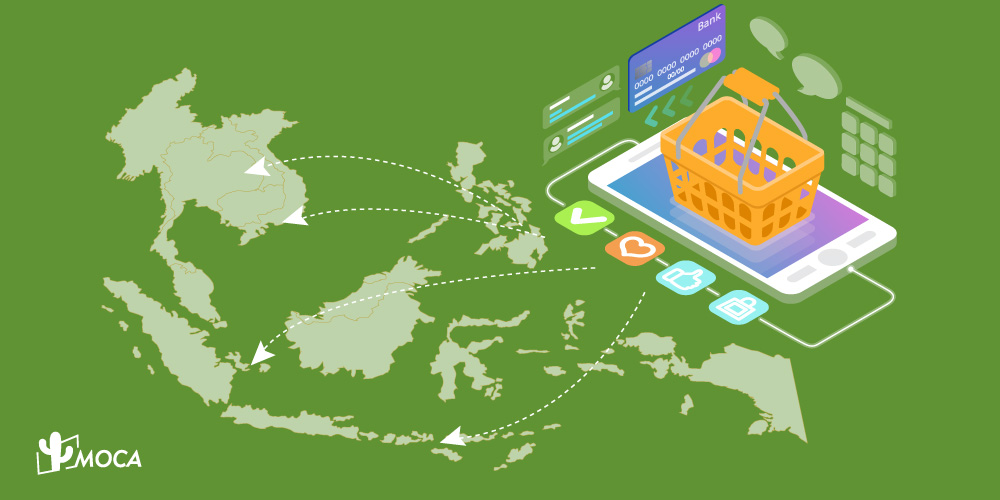

E-commerce is driving growth in Southeast Asia through pandemic-era shopping habits, e-wallet and buy-now-pay-later payments, new shoppers outside the big cities and closer regional integration. Google, Temasek and Bain forecast the region's e-commerce GMV at US$234 billion by 2025 (2021 report). This article, first published in September 2022, sets out those forecasts, the markets that led and the factors behind the growth. Figures are as reported in 2021 and 2022.

## How big is e-commerce in Southeast Asia?

In its [e-Conomy SEA 2021 report](https://services.google.com/fh/files/misc/e_conomy_sea_2021_report.pdf), Google, Temasek and Bain & Company put the region's e-commerce gross merchandise value (GMV) at US$120 billion in 2021 and forecast US$234 billion by 2025. The 2022 edition of the report revised that 2025 forecast downward, so treat it as a 2021 view rather than a current one.

[eMarketer](https://www.emarketer.com/content/southeast-asia-sees-fastest-digital-sales-growth-world) (February 2022) forecast that e-commerce sales in Southeast Asia would total US$89.67 billion in 2022, an increase of US$15.31 billion over 2021, and cross the US$100 billion mark in 2023.

The two sets of numbers differ because they use different definitions and methods, so they should not be added or compared line by line.

| Source | Measure | Figure | Year reported |
| --- | --- | --- | --- |
| Google, Temasek and Bain | E-commerce GMV, 2021 | US$120 billion | 2021 |
| Google, Temasek and Bain | E-commerce GMV forecast, 2025 | US$234 billion | 2021 |
| eMarketer | E-commerce sales forecast, 2022 | US$89.67 billion | 2022 |
| eMarketer | E-commerce sales forecast, 2023 | Above US$100 billion | 2022 |

Source: [e-Conomy SEA 2021](https://services.google.com/fh/files/misc/e_conomy_sea_2021_report.pdf) and [eMarketer](https://www.emarketer.com/content/southeast-asia-sees-fastest-digital-sales-growth-world).

> **Key finding:** According to Google, Temasek and Bain's e-Conomy SEA 2021 report, Southeast Asia's e-commerce gross merchandise value was US$120 billion in 2021 and was forecast to reach US$234 billion by 2025. eMarketer separately forecast US$89.67 billion in e-commerce sales for 2022, crossing US$100 billion in 2023.

## Which Southeast Asian markets are growing fastest?

The Philippines, Indonesia, Vietnam, Malaysia and Thailand led growth in 2022, according to [eMarketer's February 2022 forecast](https://www.emarketer.com/content/southeast-asia-sees-fastest-digital-sales-growth-world), which placed all five among the top 10 markets measured by retail e-commerce sales growth. Both eMarketer and e-Conomy SEA cover six markets in total: Indonesia, Malaysia, the Philippines, Singapore, Thailand and Vietnam. eMarketer also expected Indonesia to account for the largest share of the region's sales, and its [regional report](https://www.emarketer.com/content/southeast-asia-ecommerce-forecast-2022) included a first forecast for Shopee and Bukalapak in Indonesia.

For how the pandemic changed buying habits in the region's largest market, see [what influence the pandemic had on e-commerce in Indonesia in 2021](/news/what-influence-did-the-pandemic-have-on-the-e-commerce-market-in-indonesia-in-2021).

## What drove e-commerce growth in Southeast Asia?

The sources point to four drivers: the pandemic, shoppers outside the big cities, digital payments and regional integration.

1. The pandemic. The e-Conomy SEA 2021 report found that one in two online shoppers in Southeast Asia indicated higher purchase frequency and spend since the pandemic started.
2. Shoppers outside the big cities. The same report found that non-metro areas supplied the majority of new digital consumers in 2021.
3. Digital payments. It described e-wallets and buy-now-pay-later options as enabling a new generation of underbanked consumers to shop online.
4. Regional integration. The [ASEAN Economic Community Blueprint 2025](https://asean.org/book/asean-economic-community-blueprint-2025/) aims to facilitate the movement of goods, services, investment, capital and skilled labour within ASEAN, creating a more unified market for firms and consumers.

Sales that start on social media and messaging apps sit outside these totals. The e-Conomy SEA 2021 report calls this "informal e-commerce", says it is particularly popular in Thailand and Vietnam, and excludes it from its GMV figures because it is difficult to quantify.

> **Key finding:** The e-Conomy SEA 2021 report found that one in two Southeast Asian online shoppers bought more often or spent more since the pandemic began, that non-metro areas supplied most new digital consumers in 2021, and that e-wallets and buy-now-pay-later options opened online shopping to underbanked consumers.

## What challenges did e-commerce companies face?

The [e-Conomy SEA 2022 report](https://services.google.com/fh/files/misc/e_conomy_sea_2022_report.pdf) described growth continuing but tapering from pandemic peaks. In it, e-commerce players were reducing promotions and discounts to improve profitability, and shifting from user acquisition to engagement, which it defined as boosting the frequency, value and loyalty of existing users. Online grocery still had to overcome concerns about freshness, delivery time and pricing.

## Where does this leave brands in Southeast Asia?

Brands entering the region should read market-size forecasts as ranges that depend on who measured them and when. For how creators now influence purchases on these platforms, see [how influencer marketing is shaping e-commerce growth in Southeast Asia](/news/how-influencer-marketing-is-shaping-e-commerce-growth-in-southeast-asia) (2025) and [Q-commerce and the future of e-commerce](/news/will-q-commerce-replace-e-commerce-to-be-the-future) (2021).

## Frequently Asked Questions

### How big is e-commerce in Southeast Asia?

According to the Google, Temasek and Bain e-Conomy SEA 2021 report, e-commerce GMV in Southeast Asia was US$120 billion in 2021 and was forecast to reach US$234 billion by 2025. eMarketer, using a different measure, forecast US$89.67 billion in e-commerce sales for 2022.

### Which Southeast Asian countries have the fastest e-commerce growth?

In its February 2022 forecast, eMarketer put the Philippines, Indonesia, Vietnam, Malaysia and Thailand in the top 10 of the markets it tracks for retail e-commerce sales growth in 2022.

### What is driving e-commerce growth in Southeast Asia?

The e-Conomy SEA 2021 report points to the pandemic, which raised purchase frequency and spend for one in two online shoppers, plus e-wallets and buy-now-pay-later options and new shoppers from non-metro areas. The ASEAN Economic Community Blueprint 2025 also aims at smoother movement of goods and services.

### Does e-commerce GMV include sales made through social media?

No. The e-Conomy SEA 2021 report excludes informal e-commerce, meaning sales started on social media and messaging apps but never recorded on a retail platform. It noted this is particularly popular in Thailand and Vietnam.

### What challenges did Southeast Asian e-commerce companies face in 2022?

The e-Conomy SEA 2022 report described players reducing promotions and discounts to improve profitability and shifting from user acquisition to engagement, while online grocery still faced freshness, delivery time and pricing concerns.

*First published September 7, 2022. Updated October 25, 2026 with a clearer structure, a summary and an FAQ. Figures are as reported in 2021 and 2022; source links added, the 2025 e-commerce forecast corrected from US$240 billion to the report's US$234 billion, and the eMarketer 2022 increase corrected to US$15.31 billion. Statistics without a traceable source were removed.*
