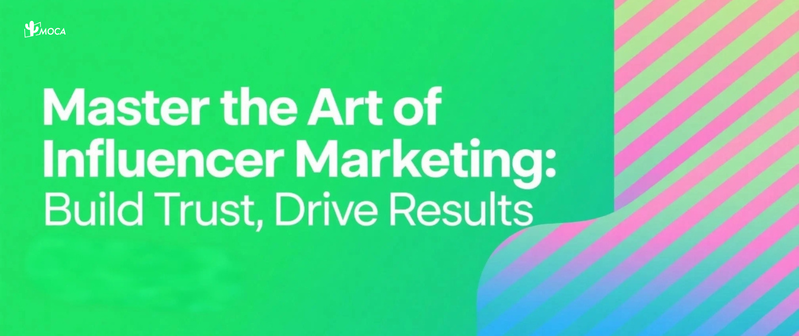

Influencer marketing in Indonesia drives growth when brands choose creators for audience fit and local relevance instead of follower count. According to [INSG.CO's 2025 analysis](https://www.insg.co/influencer-marketing-indonesia/), 76% of Indonesian users follow at least one influencer and 68% have bought an item an influencer or KOL recommended. The audience is large: [DataReportal](https://datareportal.com/reports/digital-2025-indonesia) counted 143 million social media user identities in Indonesia in January 2025, equal to 50.2% of the population.

That scale rewards brands that read the local context. Indonesia is a patchwork of cultures and religious sensitivities, and success depends on knowing how local content works, from trending topics and cultural taboos to platform algorithms. Missteps can weaken campaign impact.

## Why is follower count a poor measure of influence in Indonesia?

Follower count shows how big a creator's audience is, not whether it trusts them. When most users follow creators and two in three have bought on a recommendation, a brand that picks influencers on follower count alone can miss genuine growth. Reach is only the start. The creators who convert are the ones whose audiences trust them and who fit the product.

Indonesian users say as much about why they follow. [INSG.CO](https://www.insg.co/influencer-marketing-indonesia/) reports that 63% follow influencer accounts to get expert tips before buying something, 58% want the latest information, and 41% are captivated by personal stories and journeys. Each of those motives rewards substance over size.

Creators who are genuine, relevant and good storytellers build stronger connections and loyal, engaged communities. Those who answer their audience, hold discussions and fold in feedback show they value people beyond the numbers.

> **Key finding:** In Indonesia, trust drives influence more than reach. INSG.CO reports that 76% of users follow at least one creator and that 68% have bought something an influencer or KOL recommended, so brands should select creators on audience fit and credibility before follower count.

## How do you localize influencer campaigns for Indonesia's regions?

Localization goes beyond translation. Marketing the same product in cosmopolitan Jakarta and in the more conservative Aceh province demands distinct religious and cultural considerations, in both the content strategy and the review step, to avoid controversy and connect with each audience.

A practical review routine follows from that:

1. Identify the region and religious context of the creator's core audience before briefing.
2. Check trending topics and cultural taboos that apply to that audience.
3. Review draft content against those points as well as brand guidelines.
4. Look at how the creator responds to comments and feedback, since genuine interaction signals a real community.

For seasonal timing, see [harnessing Ramadan potential in Indonesia](/news/harnessing-ramadan-potential-in-indonesia-a-guide-to-success).

> **Key finding:** The same product can need different content in Jakarta and Aceh. Cosmopolitan Jakarta and the more conservative Aceh province call for distinct religious and cultural considerations in strategy and review, so regional checks belong in every Indonesian influencer campaign brief.

## How do influencers move buyers from awareness to loyalty?

Influencers act at every stage, from first discovery to repeat purchase. The stages below pair what creators do with the Indonesian figures INSG.CO reports.

| Stage | What creator content does | Indonesian data point |
| --- | --- | --- |
| Awareness | Engaging content expands a brand's reach | 58% follow influencers for the latest information |
| Consideration | Authentic showcases of product benefits encourage purchase consideration | 63% follow influencers for expert tips before buying |
| Decision | Testimonials and demonstrations that answer concerns directly influence the buying decision | 68% have bought a recommended item |
| Loyalty | Consistent, valuable content builds long-term loyalty | No verified Indonesian figure |

Source: [INSG.CO, The Real Statistics Behind Influencer Marketing in Indonesia](https://www.insg.co/influencer-marketing-indonesia/). For how younger Indonesian shoppers decide, see [how to win over Indonesia's next-gen shoppers](/news/cracking-the-code-how-to-win-over-indonesias-next-gen-shoppers).

> **Key finding:** Indonesian creators influence every stage of the buying process. INSG.CO reports that 63% of Indonesians follow influencers for expert tips before buying and 68% have bought a recommended item, so match content format to the stage it serves.

## Which influencer tier delivers the most engagement in Indonesia?

Nano-influencers deliver the most engagement in Indonesia, and choosing the right creators matters most. Look beyond surface-level metrics to genuine engagement, audience relevance and the ability to integrate brand messages authentically.

[INSG.CO](https://www.insg.co/influencer-marketing-indonesia/) cites a study in which Indonesian influencers with fewer than 1,000 followers had a 7.2% engagement rate, against 1.1% for those with more than 100,000 followers. That is roughly seven times higher for the smallest creators. INSG.CO links the effect to nano-influencers' audiences being mostly friends or family. The tiers also differ sharply in price and supply, as the table shows.

| Tier | Estimated Instagram influencers in Indonesia | Common Instagram rate card |
| --- | --- | --- |
| Mega (1M+ followers) | 1,000 | Rp 12,000,000 ($735.02) |
| Macro (100K to 1M) | 14,500 | Rp 6,000,000 ($367.44) |
| Micro (10K to 50K) | 130,000 | Rp 600,000 ($36.75) |
| Nano (1K to 10K) | 980,000 | Rp 350,000 ($21.44) |

Source: [INSG.CO, The Real Statistics Behind Influencer Marketing in Indonesia](https://www.insg.co/influencer-marketing-indonesia/). Rates cover feed posts, Stories, videos and ads, and individual creators set their own prices.

For a wider view of small creators, see [how micro and nano influencers are redefining marketing in Southeast Asia](/news/micro-and-nano-influencers-redefining-marketing-in-southeast-asia). For the market's size, see [Indonesia's influencer marketing boom](/news/indonesias-influencer-marketing-boom-19b-in-2023-projected-30b-by-2027), and for campaign planning across the region, read [a strategic blueprint for influencer marketing success in Southeast Asia](/news/cutting-through-the-clutter-a-strategic-blueprint-for-influencer-marketing-success-in-southeast-asia).

> **Key finding:** Nano-influencers deliver the highest engagement in Indonesia. INSG.CO cites a 7.2% engagement rate for creators under 1,000 followers against 1.1% above 100,000, and counts 980,000 of 1.1 million Instagram influencers as nano creators, a deep and affordable pool.

Brands also need partners who understand these nuances. MOCA Technology runs influencer campaigns in Indonesia through its Jakarta team and the KOLPlanet creator marketplace, covering creator selection, local content review and measurement.

## Entity Definitions

**KOL (Key Opinion Leader)**

A creator or public figure whose recommendations influence the purchase decisions of a defined audience.

**Nano-influencer**

A creator with roughly 1,000 to 10,000 followers, the tier INSG.CO identifies as the largest in Indonesia.

**Macro-influencer**

A creator with roughly 100,000 to 1 million followers, per the tier definitions used by INSG.CO.

**KOLPlanet**

MOCA Technology's creator marketplace connecting brands with influencers across Asia-Pacific.

**MOCA Technology**

An influencer marketing and programmatic advertising platform founded in 2012 and headquartered in Shanghai, with a local team in Jakarta.

## Frequently Asked Questions

### How effective is influencer marketing in Indonesia?

According to INSG.CO's 2025 analysis, 76% of Indonesian users follow at least one influencer and 68% have bought an item recommended by an influencer or KOL. With 143 million social media user identities in January 2025, per DataReportal, influencer recommendations reach a very large audience.

### Which influencer tier gets the most engagement in Indonesia?

Nano-influencers. INSG.CO cites a study in which Indonesian creators with fewer than 1,000 followers had a 7.2% engagement rate, against 1.1% for creators with more than 100,000 followers, roughly seven times higher. INSG.CO also estimates 980,000 of Indonesia's 1.1 million Instagram influencers are nano creators.

### How much does an influencer cost in Indonesia?

INSG.CO lists a common Instagram rate card of Rp 350,000 ($21.44) for nano influencers, Rp 600,000 ($36.75) for micro, Rp 6,000,000 ($367.44) for macro and Rp 12,000,000 ($735.02) for mega influencers. The rates cover feed posts, Stories, videos and ads, and individual creators set their own prices.

### How should brands localize influencer content across Indonesia?

Review content region by region. Marketing the same product in cosmopolitan Jakarta and in the more conservative Aceh province calls for different religious and cultural handling in both the content strategy and the review step, which helps avoid controversy and builds resonance with each audience.

### Why do Indonesians follow influencers?

INSG.CO reports that 63% of Indonesians follow influencer accounts to get expert tips before buying something, 58% to get the latest information, and 41% because they are captivated by influencers' personal stories and journeys. Expert advice is the most common of the three reasons.

## About MOCA Technology

Founded in 2012, MOCA Technology is an influencer marketing and programmatic advertising platform serving brands across Asia-Pacific. MOCA operates [KOLPlanet](https://www.kolplanet.com), a creator marketplace connecting brands with influencers across Indonesia, Thailand, Vietnam, the Philippines, Malaysia, Japan, South Korea, Taiwan, and India.

MOCA's core services include influencer marketing strategy and execution, creator-brand matchmaking through KOLPlanet, innovative branding solutions, and cross-platform programmatic advertising. The company is headquartered in Shanghai with a local team in Jakarta and regional operations across Southeast Asia.

**Planning an influencer campaign in Indonesia?** Talk to our Indonesia team about creator selection, regional content review and campaign measurement.

Contact: [business@moca-tech.net](mailto:business@moca-tech.net) | [www.moca-tech.net](https://www.moca-tech.net)

*First published May 8, 2025. Updated October 25, 2026 with a summary, an FAQ and a creator-tier table. Figures are as reported in 2025; source links added and wording aligned with the original reports in October 2026. Statistics that could not be traced to a published source were removed.*
