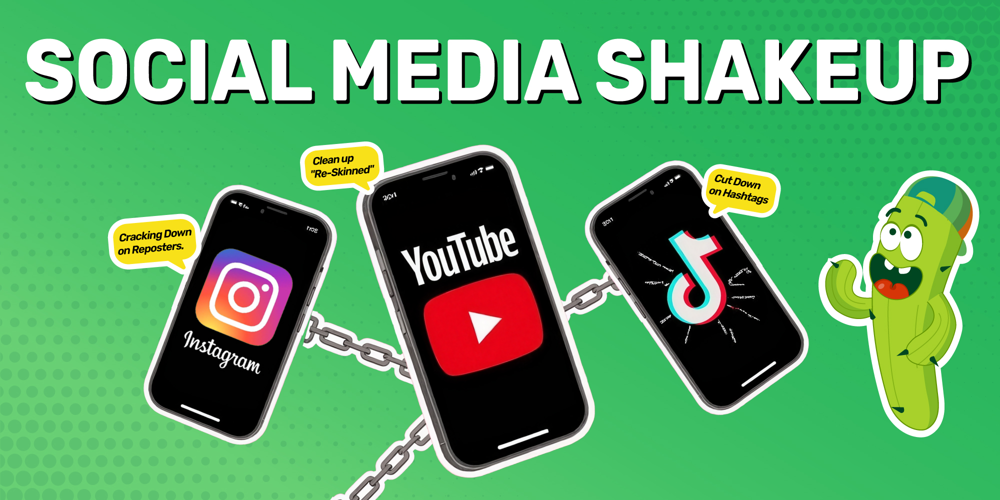

In 2025, TikTok, YouTube and Instagram each tightened rules aimed at low-effort or spam-style content. TikTok began warning users who tried to add more than five hashtags in August, YouTube renamed and clarified its inauthentic content policy on July 15, and Instagram stopped recommending aggregator accounts, first for Reels in 2024 and then for photos and carousels on April 30, 2026. The sources describe three separate changes. Our reading is that they point the same way: fewer tags, more original work and less reposting.

## What did TikTok change in August 2025?

TikTok began showing an in-app warning when users tried to add a sixth hashtag to a post. [MediaPost reported on August 21, 2025](https://www.mediapost.com/publications/article/408371/tiktok-limits-hashtags-as-algorithms-become-more-s.html) that the warning reads "Maximum 5 hashtags. Use accurate hashtags to get more views," and that TikTok had not issued a statement explaining it. [Social Media Today](https://www.socialmediatoday.com/news/tiktok-implements-five-hashtag-limit-per-post/757857/) described the same prompt on August 17, 2025, based on a user's example, and noted that Instagram was also reported to be testing a five-hashtag limit.

AI-generated content falls under a separate TikTok rule. The [Community Guidelines](https://www.tiktok.com/safety/en/policies-and-engagement/integrity-authenticity) require a label on AI-generated or significantly edited content that shows realistic-looking scenes or people. TikTok's team may remove, restrict or label unlabeled content, depending on the harm it could cause. That wording comes from the version released on August 25, 2026. We did not check the 2025 version of the page.

## What did YouTube change on July 15, 2025?

On July 15, 2025, YouTube renamed its "repetitious content" monetization policy to "inauthentic content" and clarified that it covers content that is repetitive or mass-produced. [YouTube's channel monetization policies page](https://support.google.com/youtube/answer/1311392?hl=en) calls this a minor update and says such content has always been ineligible for monetization. The reused content policy, which reviews commentary, clips, compilations and reaction videos, did not change.

The same page says monetizing content should be your original creation and should not be mass-produced, generic, repetitive or manipulative. Its enforcement actions include limiting ad earnings and suspending a channel's participation in the YouTube Partner Program. [Search Engine Journal reported on July 2, 2025](https://www.searchenginejournal.com/youtube-targets-mass-produced-content-in-monetization-update/550337/) that channels publishing mass-produced or repetitive content risk removal from the program, and that YouTube had not yet said how it would enforce the update.

## How does Instagram treat aggregator accounts?

Instagram announced in 2024 that it would stop recommending aggregator accounts, and it widened the rule in 2026. [TechCrunch reported on April 30, 2024](https://techcrunch.com/2024/04/30/instagram-is-updating-its-ranking-systems-to-surface-more-content-from-smaller-original-creators/) that Instagram would recommend only the original when it finds identical content, label reposts, and stop recommending accounts that repeatedly post content they did not create or enhance. That change did not affect how people see content from aggregator accounts they follow.

On April 30, 2026, [Instagram announced](https://creators.instagram.com/blog/rewarding-original-creators-on-instagram) that the Reels protections now cover photos and carousels as well. Accounts that mostly post unoriginal content in those formats no longer appear in Instagram's recommendations. Followers still see them. They become eligible again when most of an account's recent photos, carousels and Reels are original over a rolling 30-day period.

Instagram adds that [75% of recommendations in the US](https://creators.instagram.com/blog/rewarding-original-creators-on-instagram) now come from original posts. [Mashable](https://mashable.com/article/instagram-algorithm-original-content-creators) notes one tip: accounts that reshare often are pointed to story shares, the repost button and collab posts.

## How do the changes compare?

| Platform | What changed | Date | Source |
| --- | --- | --- | --- |
| TikTok | In-app warning at more than five hashtags per post | Reported August 17 to 21, 2025 | [MediaPost](https://www.mediapost.com/publications/article/408371/tiktok-limits-hashtags-as-algorithms-become-more-s.html) |
| TikTok | Label required on realistic AI-generated or edited content | Guidelines version effective September 24, 2026 | [TikTok Community Guidelines](https://www.tiktok.com/safety/en/policies-and-engagement/integrity-authenticity) |
| YouTube | Repetitious content policy renamed inauthentic content | July 15, 2025 | [YouTube Help](https://support.google.com/youtube/answer/1311392?hl=en) |
| Instagram | Aggregator accounts not recommended (Reels) | April 30, 2024 | [TechCrunch](https://techcrunch.com/2024/04/30/instagram-is-updating-its-ranking-systems-to-surface-more-content-from-smaller-original-creators/) |
| Instagram | Same rule extended to photos and carousels | April 30, 2026 | [Instagram Creators](https://creators.instagram.com/blog/rewarding-original-creators-on-instagram) |

## What do the numbers look like in Malaysia and Indonesia?

In Malaysia, [Statcounter's July 2025 figures](https://gs.statcounter.com/social-media-stats/all/malaysia/#monthly-202507-202507-bar) put Facebook at 82.38% of the social media page views it tracks. The figure counts referral traffic to websites. It does not measure the share of users or of commerce, so it says little about which platform sells more.

In Indonesia, [AfterShip's TikTok Shop statistics](https://www.aftership.com/ecommerce/statistics/tiktok-shop) list 54.28K stores, or 20.52% of the 264.48K stores it tracks, the largest share of any country in its table. The page counts stores rather than individual sellers and does not date its snapshot. We found no source that measures how the hashtag limit affected these stores. For the market background, see [TikTok Shop's Indonesia comeback](/news/tiktok-shop-indonesia-ban-to-13-billion-gmv-comeback).

## What should creators do?

1. Keep TikTok captions to five hashtags or fewer, and pick tags that describe the video.
2. Apply TikTok's AI label to videos that show realistic scenes or people created or heavily changed by AI.
3. Give every YouTube upload its own script, footage and angle, so no channel reads as mass-produced or repetitive.
4. On Instagram, add your own commentary or graphics to material built on someone else's work, or share it through story shares, the repost button or collab posts.
5. Concentrate on one or two platforms you can feed with original work, rather than posting the same clip everywhere. That is our view and no platform requires it.

## What should brands do?

Plan content for each platform instead of publishing one file on all three. A hashtag-heavy caption, a re-uploaded clip and a templated series each run into a different rule above.

Pick creators by audience fit. Ask for audience and engagement data before you rely on follower counts.

[Micro and nano influencers](/news/micro-and-nano-influencers-redefining-marketing-in-southeast-asia) are one option, though we found no source showing a specific ROI advantage over larger creators. Then test in small batches. Re-check each platform's rules before you scale, because all three have changed them since 2025. For TikTok's compliance rules in Southeast Asia, see [how Southeast Asian brands must adapt](/news/tiktoks-new-compliance-wave-how-southeast-asian-brands-must-adapt-in-2025).

## Frequently Asked Questions

### How many hashtags can you use on TikTok?

TikTok began showing a Maximum 5 hashtags warning in August 2025 when users tried to add more. At the time of the reports we reviewed, TikTok had not issued a statement explaining the change. The warning tells creators to use accurate hashtags, so each tag should describe what the video is about.

### What is YouTube's inauthentic content policy?

On July 15, 2025, YouTube renamed its repetitious content policy to inauthentic content and clarified that it covers content that is repetitive or mass-produced. YouTube says this type of content has always been ineligible for monetization. The separate reused content policy for commentary, clips, compilations and reaction videos did not change.

### Does Instagram stop recommending accounts that repost other people's content?

Yes. Instagram said in April 2024 that accounts which repeatedly post content they did not create or enhance would stop being recommended. On April 30, 2026, it extended the rule from Reels to photos and carousels. Followers still see these accounts, and an account can regain eligibility when most of its recent posts are original over 30 days.

### Do creators have to label AI-generated content on TikTok?

Yes, for realistic content. TikTok's Community Guidelines require a label when AI-generated or significantly changed content shows realistic-looking scenes or people, and unlabeled posts can be removed, restricted or labeled by TikTok, depending on the harm. This reflects the version effective September 24, 2026.

### How many TikTok Shop stores are there in Indonesia?

AfterShip's TikTok Shop statistics list 54.28K stores in Indonesia, which is 20.52% of the 264.48K stores it tracks and the largest share of any country in its table. The figures count stores rather than individual sellers, and AfterShip does not date the snapshot on the page.

## About MOCA Technology

Founded in 2012, MOCA Technology is an influencer marketing and programmatic advertising platform serving brands across Asia-Pacific. MOCA operates [KOLPlanet](https://www.kolplanet.com), a creator marketplace connecting brands with influencers across Indonesia, Thailand, Vietnam, the Philippines, Malaysia, Japan, South Korea, Taiwan, and India.

MOCA's core services include influencer marketing strategy and execution, creator-brand matchmaking through KOLPlanet, innovative branding solutions, and cross-platform programmatic advertising. The company is headquartered in Shanghai with a local team in Jakarta and regional operations across Southeast Asia.

**Adjusting a creator plan to new platform rules?** Talk to our Indonesia team about creator-led campaigns that fit each platform's current rules.

Contact: [business@moca-tech.net](mailto:business@moca-tech.net) | [www.moca-tech.net](https://www.moca-tech.net)

*First published August 21, 2025. Updated October 25, 2026 with sourced facts, a platform comparison and an FAQ. Figures are as reported in 2025 unless a later date is given; source links added in October 2026. Wording corrected to match the sources: TikTok's hashtag limit is an in-app warning reported by users rather than an official announcement, YouTube's change is a clarification of an existing policy, and Instagram's aggregator rule dates from 2024. Claims we could not source were removed, including a 340% ROI figure, an unnamed MCN executive's quote and a Malaysian age-group claim.*
