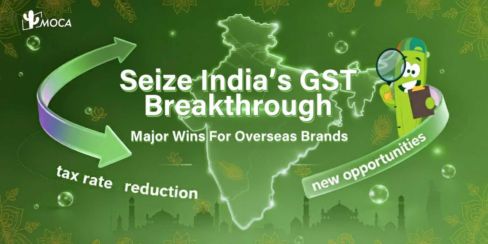

India's 2025 GST reform gave brands lower consumer prices on everyday goods and appliances and a simpler rate structure: two main rates, 5% and 18%, plus a 40% rate for a select few goods and services. The 56th GST Council recommended the change in New Delhi on 3 September 2025, according to the [Press Information Bureau (PIB)](https://pib.gov.in/PressReleasePage.aspx?PRID=2163555), and almost all of it took effect on 22 September 2025, days before the festive shopping season.

## What changed in India's GST rates?

The Council cut GST on everyday goods to 5%, moved appliances and small cars from 28% to 18%, and created a 40% rate for a select few items. The PIB release describes the package as the "next-generation GST reforms" announced by Prime Minister Narendra Modi on 15 August 2025, and the examples below come from it.

| Change | Examples named by the GST Council |
| --- | --- |
| 18% or 12% to 5% | Hair oil, toilet soap bars, shampoos, toothbrushes, toothpaste, bicycles, kitchenware |
| 5% to nil | UHT milk, packaged paneer, Indian breads such as chapati and paratha |
| 28% to 18% | Air-conditioners, TVs, dishwashing machines, small cars, motorcycles up to 350cc, cement |
| 18% to 5% (services) | Gyms, salons, barbers and yoga centres |
| 12% to 5% (services) | Hotel rooms priced at or below Rs 7,500 per night |
| 28% to 40% | Pan masala, sweetened or flavoured aerated drinks, caffeinated beverages, larger cars, motorcycles above 350cc, yachts, personal aircraft, casino admission |

Source: [PIB, 3 September 2025](https://pib.gov.in/PressReleasePage.aspx?PRID=2163555).

The 40% rate covers pan masala, sweetened or flavoured aerated drinks, caffeinated beverages, cars above the small-car limits, motorcycles above 350cc, yachts, personal aircraft, casino admission and tobacco products. Tobacco and pan masala were phased separately, as explained below.

The PIB release lists personal care items such as hair oil, soap and shampoo among the common-man goods cut to 5%, and gym and salon services among the services cut from 18% to 5%. It does not rank categories by the size of the cut, so this article does not claim that any one category gained the most.

> **Key finding:** The 56th GST Council cut GST on everyday goods from 18% or 12% to 5%, moved air-conditioners, TVs and small cars from 28% to 18%, and created a 40% rate for a select few goods and services. Changes to services and almost all goods took effect on 22 September 2025.

## When did the new GST rates take effect?

The Council set 22 September 2025 as the start date for rate changes on services and on all goods except tobacco-related products. PIB's [FAQ release of 18 September 2025](https://pib.gov.in/PressReleasePage.aspx?PRID=2168426) confirms that the goods rates were notified in Notification No. 9/2025-Central Tax (Rate) dated 17 September 2025, which replaced the 2017 notification. The Integrated Tax (Rate) notification agrees. It comes into force on 22 September 2025 ([CBIC notification](https://courier.cbic.gov.in/ECCS/advisory/2025/NOTIFICATION%20NO.%209_2025-INTEGRATED%20TAX%20%28RATE%29%20-1759486719.pdf)).

Pan masala, gutkha, cigarettes, chewing tobacco products, unmanufactured tobacco and bidi were excluded from that date. According to PIB, they stay at existing rates until the loan and interest obligations under the compensation cess account are discharged, and the Union Finance Minister may decide the actual transition date. Check the current Central Board of Indirect Taxes and Customs (CBIC) notifications before pricing any tobacco-related product.

> **Key finding:** CBIC notified the new goods rates on 17 September 2025 and applied them from 22 September 2025. Tobacco-related goods followed a separate schedule tied to the compensation cess account, so brands in those categories should confirm the rate in force on the date of sale.

## Which brand categories gained from the lower rates?

Appliances show the clearest demand signal in the sources. Redseer, a consulting firm that tracks Indian e-commerce, reported that early data showed [MRPs of leading TV brands falling 6% to 8%](https://redseer.com/articles/festive-2025-day-0-ecommerce-sales-surge-25-with-gst-boost-demand-led-by-smartphones-and-tvs/) after GST on TVs above 32 inches fell from 28% to 18%, before festive discounts were added. The same report said GST on mobile phones stayed at 18%, and that smartphone sales in the first days were driven by bank tie-ups, EMI schemes, high demand and higher discounts rather than by a tax cut.

Analysts also expected a lift before the sale season opened. [ETtech reported on 5 September 2025](https://economictimes.indiatimes.com/tech/technology/analysts-expect-festive-online-sales-to-grow-30-after-gst-relief/articleshow/123704607.cms) that analysts expected festive online sales to grow 30%, that Amazon India would open its Great Indian Festival on 23 September, and that marketplaces were expected to ship Rs 1.2 lakh crore of goods, a 25% increase from 2024. That 30% was an analyst forecast and was not a measured result.

> **Key finding:** Redseer measured online retail GMV up 23% to 25% year on year on 22 and 23 September 2025, four to five times the growth of the first two days of the 2024 festive sales. TV sales rose partly on the GST cut, while phones, still at 18%, also sold strongly, so the tax change explains only part of early demand.

## How did consumer demand respond?

After the reform, [gross GST collections for October 2025 reached Rs 1,95,936 crore](https://pib.gov.in/PressReleasePage.aspx?PRID=2185839), 4.6% higher than October 2024, according to PIB. The same release said the rise indicated sustained consumer demand during the festive season, and it showed gross domestic GST revenue up 2.0% and import revenue up 12.9%. One month of collections does not isolate the effect of the rate cuts, so treat it as a demand signal rather than proof of cause.

MOCA Technology, which has operated across Southeast Asia and India since 2012, treats the rate cuts as a pricing signal for campaign planning and does not assume a guaranteed lift. The Redseer data shows uptake differed by category, and the audience is large: the [IAMAI and Kantar report Internet in India 2024](https://www.iamai.in/sites/default/files/research/Kantar_%20IAMAI%20report_2024_.pdf) counted 886 million active internet users in India in 2024, 488 million of them in rural India and 397 million in urban India.

> **Key finding:** In 2024, India had 886 million active internet users, and rural India accounted for more of them (488 million) than urban India (397 million), according to IAMAI and Kantar. Price-led campaigns can reach a broad audience, but categories react differently to a tax cut.

## What should brands check before planning India campaigns?

1. Map every product to its HSN (Harmonised System of Nomenclature) code and compare it with the rate schedules in the 17 September 2025 CBIC notifications.
2. Review the shelf price or MRP for products whose rate fell. Redseer saw MRPs of leading TV brands drop 6% to 8% after the cut, so price comparisons on marketplaces changed.
3. Confirm what the Council's release covers. We did not find advertising services among its listed rate changes, so ask a tax adviser how your own media and agency invoices are treated.
4. Plan creative and creator content around the festive window, from Navratri to Diwali, rather than only around the tax change itself. For a worked example of festive influencer planning, see [how influencers drove Diwali shopping in 2024](/news/diwali-shopping-trends-2024-influencers-drive-purchase).
5. Track results by category, since Redseer ties TV growth partly to the cut and ties phone sales to discounts and demand. For the wider market context, see [India's digital ad spend](/news/indias-digital-ad-spend-hits-new-heights) and [opportunities in India's digital economy](/news/unveiling-opportunities-in-indias-thriving-digital-economy).

## Entity Definitions

**GST (Goods and Services Tax)**

India's indirect tax on the supply of goods and services, introduced in 2017 and levied at rates set by the GST Council.

**GST Council**

The body chaired by India's Union Finance Minister that recommends GST rates and rules. Its 56th meeting took place on 3 September 2025.

**CBIC (Central Board of Indirect Taxes and Customs)**

The Indian government body that issues GST rate notifications, including Notification No. 9/2025 of 17 September 2025.

**HSN code (Harmonised System of Nomenclature)**

The product classification code used to look up the GST rate for a good.

**MRP (maximum retail price)**

The highest price at which a packaged product can be sold to consumers in India.

**GMV (gross merchandise value)**

The total value of goods sold through a platform before returns and costs.

**KOLPlanet**

MOCA Technology's creator marketplace, which connects brands with influencers across Asia-Pacific.

## Frequently Asked Questions

### When did India's new GST rates take effect?

Changes to GST rates on services and on almost all goods took effect on 22 September 2025, after the 56th GST Council met on 3 September 2025. Pan masala, gutkha, cigarettes, chewing tobacco products, unmanufactured tobacco and bidi stayed at their existing rates until the compensation cess obligations are discharged.

### What are India's GST rates after the 2025 reform?

The four-tier structure became two main rates: a standard rate of 18% and a merit rate of 5%. A special 40% rate applies to a select few goods and services, and some items such as UHT milk and Indian breads are now nil-rated.

### Which goods moved to the 40% GST rate?

The 40% rate covers pan masala, sweetened or flavoured aerated drinks, caffeinated beverages, cars above the small-car limits, motorcycles above 350cc, yachts, personal aircraft, casino admission and tobacco products. Tobacco and pan masala were phased separately.

### Did mobile phones get a GST cut in 2025?

No. Redseer reported that GST on mobile phones stayed at 18%. Redseer said premium smartphone sales in the first festive days were driven by bank tie-ups, EMI schemes, high demand and higher discounts, while the GST cut on TVs above 32 inches lifted TV sales.

### How did online shopping respond to the GST cuts?

Redseer reported that online retail GMV grew 23% to 25% year on year on 22 and 23 September 2025, four to five times the growth in the first two days of the 2024 festive sales. Gross GST collections for October 2025 were 4.6% higher than a year earlier.

## About MOCA Technology

Founded in 2012, MOCA Technology is an influencer marketing and programmatic advertising platform serving brands across Asia-Pacific. MOCA operates [KOLPlanet](https://www.kolplanet.com), a creator marketplace connecting brands with influencers across Indonesia, Thailand, Vietnam, the Philippines, Malaysia, Japan, South Korea, Taiwan, and India.

MOCA's core services include influencer marketing strategy and execution, creator-brand matchmaking through KOLPlanet, innovative branding solutions, and cross-platform programmatic advertising. The company is headquartered in Shanghai with a local team in Jakarta and regional operations across Southeast Asia.

**Planning an India campaign around the new GST rates?** Talk to our team about creator-led and mobile campaigns for India's festive season.

Contact: [business@moca-tech.net](mailto:business@moca-tech.net) | [www.moca-tech.net](https://www.moca-tech.net)

*First published September 12, 2025. Updated October 25, 2026 with sourced rate details, a clearer structure, a summary and an FAQ. Figures are as reported in 2025; source links added, wording aligned with the original sources, and unsourced estimates removed in October 2026.*
